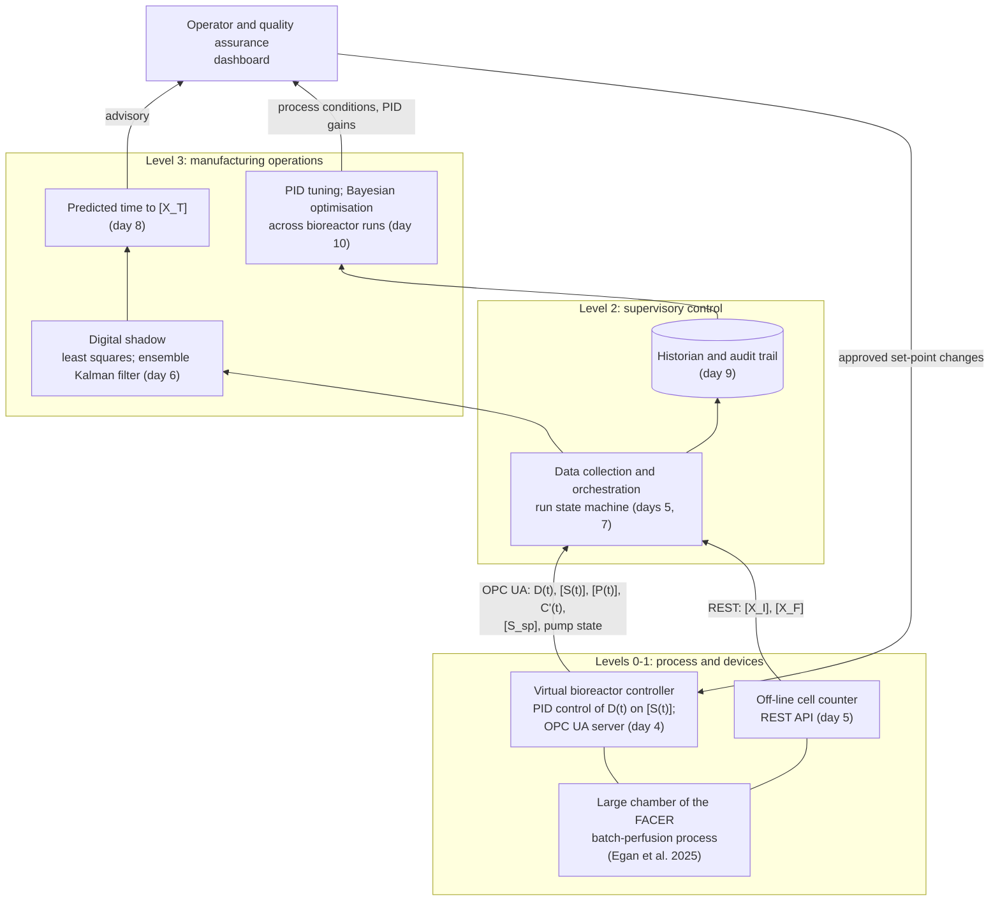

# System architecture

The virtual bioreactor, the digital shadow and the supervisory components are arranged on the
levels of the ISA-95 (IEC 62264) model. A digital shadow receives data from the physical component
only (one-way transfer); a digital twin also transfers data back and can adaptively control the
process (Egan et al., 2025). The digital shadow is an advisory tool for a human operator, who
decides the harvest time.

## Control and decision layers

| Layer | Time scale | Implementation | Decision |
| --- | --- | --- | --- |
| PID control of the perfusion rate | 10 s | `control/perfusion.py` | controller, within D_min and the pump limit |
| Digital shadow: nowcasts and short-term forecasts of [X(t)] | hours, per bioreactor run | `shadow/fit.py` | operator and quality assurance (harvest time) |
| Process development across runs | between bioreactor runs | day 10 | process development |

## Implemented components

- `process/`: cell growth model, observed and best-fit parameters, batch-perfusion process model.
- `control/perfusion.py`: PID controller of the perfusion rate; `control/pid.py`: generic PI
  controller used as the example in the control refresher notes.
- `sensors/`: enzymatic glucose and lactate sensors with bubble artefacts and the Butterworth
  filter, DO sensor, off-line cell counts.
- `sim/`: virtual bioreactor run and accelerated clock.
- `shadow/`: digital shadow training and testing, confidence bands, time to a threshold cell
  concentration.
