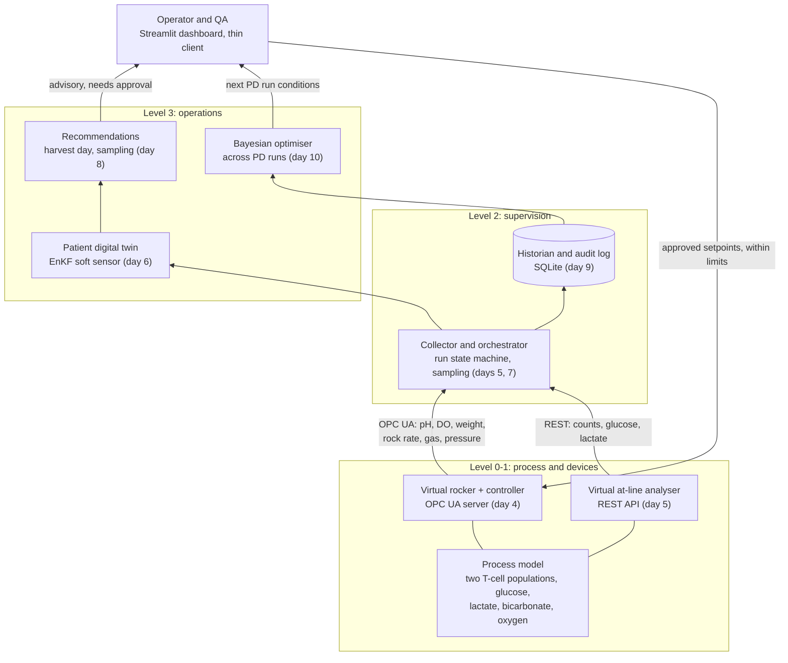

# Architecture

The demo follows one autologous CAR-T batch through a perfused rocking-bag
expansion. Each layer is its own component, placed on the ISA-95 levels, so
the software around the model looks like a real deployment.

## The three loops

| Loop | Timescale | Where it lives | Decides |
| --- | --- | --- | --- |
| Inner | seconds to minutes | `control/rocker.py`: pH by CO2, DO by rock rate then O2, perfusion schedule | the controller, within hard limits |
| Run | hours, one patient | EnKF soft sensor and recommendations (days 6 to 8) | operator and QA |
| Campaign | between process-development runs | Gaussian-process Bayesian optimisation (day 10) | the process development team |

## What exists now (days 1 to 3)

- `process/parameters.py`: every parameter with unit, status and source, the
  literature anchors, and patients A and B.
- `process/model.py`: the ODEs, the rates shared with the soft sensors (OUR,
  acid production), and the observables.
- `control/pid.py`, `control/rocker.py`: the inner loop.
- `sim/runner.py`: a batch stepped one control interval at a time, with a
  recorded history; `sim/clock.py`: the accelerated clock for live mode.
- `sensors/`: online channels with noise, drift and faults; at-line
  analysers with turnaround and sample cost; flow cytometry at harvest; soft
  measurements of oxygen uptake and acid production. See [sensors.md](sensors.md).
