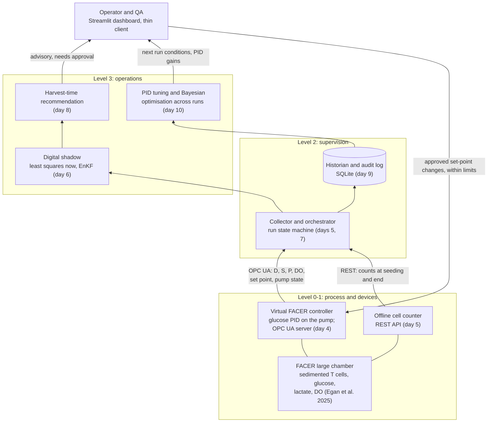

# Architecture

The demo follows one autologous CAR-T batch through a FACER perfusion expansion. Each layer is
its own component, placed on the ISA-95 levels, so the software around the model looks like a
real deployment.

## The three loops

| Loop | Timescale | Where it lives | Decides |
| --- | --- | --- | --- |
| Inner | 10 s | `control/perfusion.py`: PID on filtered glucose, setting the perfusion rate | the controller, within D_min and the pump limit |
| Run | hours, one patient | the digital shadow and its harvest forecast | operator and QA |
| Campaign | between runs | PID tuning and Bayesian optimisation (day 10) | the process development team |

A digital shadow only receives data (physical to virtual); a digital twin also acts back on the
process. Egan et al. argue the shadow's advisory role keeps regulatory risk low: it predicts, a
person decides.

## What exists now

- `process/`: growth model, published runs, mass balances.
- `control/perfusion.py`: the glucose PID; `control/pid.py`: a generic PI kept for the control notes.
- `sensors/`: enzymatic glucose and lactate with bubbles and filtering, DO, offline counts.
- `sim/`: the virtual FACER run and the accelerated clock.
- `shadow/`: training and real-time fits, confidence bands, harvest time.
